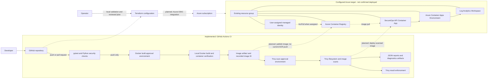

# SecureOps API - Azure DevSecOps Automation Platform

[](https://github.com/SpecialMeDevOps/azure-devsecops-enterprise/actions/workflows/ci.yml)


SecureOps API is a small FastAPI service used to demonstrate application testing, container hardening, security scanning, and an Azure infrastructure-as-code template. The repository contains a working API, a Docker/Compose setup, a GitHub Actions CI workflow, and Terraform configuration for Azure Container Apps.

> **Deployment status:** The CI and Terraform configurations are present, but this repository does not show that Azure resources have been provisioned or that the application has been deployed. The current CI workflow does not push an image to ACR. The latest available CI run failed at Trivy enforcement; see the [latest CI and Trivy status](#latest-available-github-actions-result).

## Contents

- [Project status](#project-status)
- [Architecture](#architecture)
- [Technology stack](#technology-stack)
- [API](#api)
- [Run locally](#run-locally)
- [Container build and run](#container-build-and-run)
- [CI workflow](#ci-workflow)
- [Terraform infrastructure](#terraform-infrastructure)
- [Security practices and limitations](#security-practices-and-limitations)
- [Repository structure](#repository-structure)
- [Roadmap](#roadmap)

## Project status

| Area | Repository evidence | Azure/live status |
|---|---|---|
| FastAPI service and tests | Implemented in `app/` and `tests/` | No hosted endpoint verified |
| Dockerfile and Compose hardening | Implemented | Image is built and checked by CI; no registry push verified |
| GitHub Actions CI | Implemented in `.github/workflows/ci.yml` | Latest available run failed during Trivy enforcement |
| Terraform Azure template | Implemented in `terraform/`; local format, initialization, and validation have passed | No Terraform apply or Azure provisioning verified |
| GitHub-to-Azure OIDC | Described as a future integration | No Azure login or OIDC deployment job is configured |
| ACR-to-Container Apps release | Terraform configuration supports the infrastructure side | No image publishing or application release workflow is configured |

Terraform's default resource modes are `reference`, and public ingress defaults to disabled. The live existence and settings of the supplied Azure resource group, ACR, and other resources have not been verified by this repository.

## Architecture

The diagram distinguishes the implemented CI path from the operator-driven Terraform configuration and the planned Azure release integration. Azure resources and Azure OIDC are configuration targets, not evidence of a deployment.



### Implemented CI flow

- Pull requests run the test and Python security job.
- Pushes run that job first, then reference `docker-build-approval` before building and verifying a local image.
- The verified image is saved as a GitHub Actions artifact with an image ID.
- The Trivy job references `trivy-scan-approval`, downloads that artifact, loads it, and verifies its image ID before scanning.
- The workflow uploads reports and diagnostics. It has no Terraform, Azure login, ACR push, or Container Apps deployment job.

The workflow YAML names the approval environments, but required reviewers are a repository setting and are not established by YAML alone. Confirm their protection rules in GitHub repository settings.

### Azure provisioning and release are separate concerns

The Terraform files describe Azure infrastructure; they are not a GitHub Actions Terraform workflow and do not provision resources automatically. The AzureRM provider can be used with local Azure CLI authentication. An OIDC-based GitHub workflow and an image publish/deploy workflow remain planned integrations. Do not treat Terraform configuration or a successful local `terraform validate` as evidence that Azure resources exist.

## Technology stack

| Technology | Use in this repository |
|---|---|
| Python 3.12 | Application runtime and CI test environment |
| FastAPI, Pydantic Settings, Uvicorn | API, environment-based settings, and ASGI server |
| pytest and HTTPX | Endpoint tests |
| Docker BuildKit | Multi-stage image build |
| Docker Compose | Local container run with additional restrictions |
| GitHub Actions | Test, scan, build, container verification, and artifact workflow |
| Bandit | Python static security analysis |
| pip-audit | Dependency vulnerability audit |
| Trivy | Filesystem and local image vulnerability scans |
| Terraform and HashiCorp AzureRM provider | Azure infrastructure configuration |
| Azure Container Registry, Container Apps, Log Analytics, Managed Identity | Terraform target resources; not confirmed provisioned |

The runtime dependency ranges are in [`requirements.txt`](requirements.txt); test dependencies are in [`requirements-dev.txt`](requirements-dev.txt). Bandit and pip-audit versions are pinned in the workflow. The Terraform provider is constrained to AzureRM 4.x and selected as 4.81.0 in [`terraform/.terraform.lock.hcl`](terraform/.terraform.lock.hcl).

## API

The service is version `0.1.0`. Settings use the `SECUREOPS_` prefix; environment variables override the optional `.env` file. Defaults are application name `SecureOps API`, environment `development`, and log level `INFO`.

| Method and path | Behavior |
|---|---|
| `GET /` | Returns the configured application name and welcome message. |
| `GET /health` | Returns `{"status":"healthy"}`. This is a simple liveness response; it does not check external dependencies. |
| `GET /api/v1/info` | Returns the application name, API version, and configured environment. |
| `GET /api/v1/status` | Logs that the status endpoint was requested and returns `{"status":"running"}`. |

FastAPI's `/docs` and `/openapi.json` endpoints are also available. The API currently has no authentication or authorization; do not expose it publicly without deciding how access should be protected.

### Try the API

After starting the app, these commands work in PowerShell:

```powershell
curl.exe -i http://127.0.0.1:8000/
curl.exe -i http://127.0.0.1:8000/health
curl.exe -i http://127.0.0.1:8000/api/v1/info
curl.exe -i http://127.0.0.1:8000/api/v1/status
```

## Run locally

From a clone of this repository, create and activate a Python 3.12 virtual environment.

**Windows PowerShell**

```powershell
py -3.12 -m venv .venv
.\.venv\Scripts\Activate.ps1
python -m pip install -r requirements-dev.txt
python -m uvicorn app.main:app --reload
```

**Linux or macOS**

```bash
python3.12 -m venv .venv
source .venv/bin/activate
python -m pip install -r requirements-dev.txt
python -m uvicorn app.main:app --reload
```

The development requirements include the runtime requirements and test dependencies. Open `http://127.0.0.1:8000/docs` to use the interactive API documentation.

Run the tests from the repository root:

```powershell
python -m pytest -ra
```

The current test file covers the four API routes and an unknown-route 404 response.

## Container build and run

Build the image from the repository root:

```powershell
docker build -t secureops-api:local .
```

To run with the repository's Compose configuration:

```powershell
docker compose up --build
```

In another terminal, check `http://127.0.0.1:8000/health` or use the API commands above. Stop the service with:

```powershell
docker compose down
```

Compose publishes port 8000 on the host. The Compose service sets UID/GID `10001:10001`, uses a read-only root filesystem, provides a restricted `/tmp` tmpfs, drops Linux capabilities, enables `no-new-privileges`, and limits process count, CPU, and memory.

## Docker security

The [`Dockerfile`](Dockerfile) uses a builder stage to build wheels and a separate `python:3.12-slim-bookworm` runtime stage. It upgrades available OS packages during the build, installs the runtime requirements from the wheelhouse, copies only the app into the runtime image, and runs as UID/GID `10001:10001`. It exposes container port 8000 and defines a Docker health check against `/health`.

The [`compose.yaml`](compose.yaml) adds local runtime restrictions. These are configuration controls, not a security certification. The Docker base image uses a version tag rather than a digest, and runtime dependencies are version ranges; image and dependency reproducibility remain improvement areas.

## CI workflow

The single workflow, [`.github/workflows/ci.yml`](.github/workflows/ci.yml), triggers on `push` and `pull_request`. It grants `contents: read` at workflow scope. Build and scan jobs run only for pushes.

| Stage | What the workflow does | Gate behavior |
|---|---|---|
| Checkout and Python setup | Checks out source, configures Python 3.12, and caches pip dependencies. | Required for the job. |
| pytest | Runs `python -m pytest -ra` and writes a JUnit report. | A test failure fails the job. |
| Bandit | Runs pinned Bandit 1.9.4 recursively on `app/`, writes JSON, and uses `--exit-zero`. | **Report-only for findings**; finding severity does not fail this step. A separate enforcement step fails if the scanner itself did not complete successfully. |
| pip-audit | Runs pinned pip-audit 2.10.1 with `--strict`, auditing `requirements-dev.txt` and writing JSON. | Its step outcome is checked by the Python security enforcement step. |
| Python reports | Uploads JUnit and Python security diagnostics. | Runs with `if: always()`; artifact retention is 7 days. |
| Docker build approval | The build job references the `docker-build-approval` GitHub Environment. | Actual manual approval depends on that environment's configured protection rules. |
| Docker build and verification | Builds locally with `push: false`, verifies the container health, endpoints, and UID/GID, then saves the image and image ID as an artifact. | A build or verification failure stops the job; the image is not pushed to a registry. |
| Trivy scan approval | The scan job references the `trivy-scan-approval` GitHub Environment. | Actual manual approval depends on that environment's configured protection rules. |
| Trivy scans | Scans the filesystem and the downloaded local image for vulnerabilities at `HIGH,CRITICAL`; the image scan covers OS and library vulnerabilities. Both produce JSON reports. | Scan steps continue long enough to upload diagnostics, but the final enforcement step fails if either scan outcome is unsuccessful. This is a **strict gate**, not a finding suppression. |
| Security reports | Uploads Trivy reports and diagnostics. | Runs with `if: always()`; artifact retention is 7 days. |

### Latest available GitHub Actions result

The latest run inspected was [CI run #7](https://github.com/SpecialMeDevOps/azure-devsecops-enterprise/actions/runs/45036822655) on `main`, for commit `dcedc44` on November 22, 2026:

- The pytest and Python security job succeeded.
- Docker build and container verification succeeded.
- The Trivy image report contained **99 HIGH and 2 CRITICAL vulnerability findings**. Trivy identified Debian 12.15 in the image; findings include Debian OS packages.
- Trivy enforcement failed the workflow, as intended. The Trivy JSON report and diagnostics were uploaded.
- The filesystem report from that run contained no vulnerability entries.

These are findings from that specific run, not a claim about later images or scan results. Remediating the Debian base-image vulnerabilities and rerunning CI is an open task. The workflow status badge above reflects the latest GitHub Actions status and may change with later runs.

## Terraform infrastructure

The [`terraform/`](terraform/) directory contains a single root module for the proposed Azure deployment. Its [Terraform README](terraform/README.md) documents inputs, ownership modes, import safety, remote state, authentication, and plan review.

| Resource or configuration | What the code declares | Deployment status |
|---|---|---|
| Resource group | `data.azurerm_resource_group` reference to `rg-secureops-dev`; no resource-group creation block. | Live group and region not verified. |
| ACR | `create` or `reference` mode; creation uses Basic by default and disables the admin user. Modes default to `reference`. | ACR existence, SKU, settings, and permissions are not verified. |
| Log Analytics Workspace | `create` or `reference` mode; created workspace defaults to 30-day retention. | Not confirmed provisioned. |
| Container Apps Environment | `create` or `reference` mode, with Log Analytics workspace integration. | Not confirmed provisioned. |
| User-assigned managed identity | `create` or `reference` mode for the identity used to pull the image. | Not confirmed provisioned. |
| ACR pull RBAC | Optional `AcrPull` assignment at registry scope. Management is disabled by default; app creation requires a managed or explicitly confirmed existing assignment. | Role assignment is not confirmed in Azure. Check registry permission mode before using `AcrPull`; repository-ABAC may need a different scoped role. |
| Container App | `create` or `reference` mode. Uses an existing ACR image, managed identity, port 8000, HTTP scaling, and startup/readiness/liveness probes on `/health`. | App and image are not confirmed deployed. |
| Ingress | HTTPS-only ingress configuration; external ingress defaults to `false`. | No public endpoint is configured by default. |

Resource modes default to `reference` to avoid silently creating duplicates. A data-source lookup will fail if the named resource is absent. Only change a resource mode to `create` after a read-only Azure inventory confirms it does not already exist. Existing resources can be imported only through a deliberate manual import after checking ownership and reviewing the plan; this configuration does not import automatically. `prevent_destroy` protects managed ACR and workspace resources.

The module requires the intended image to already exist in ACR before creating the app. It does not build or push that image. No Terraform apply has been run, and the repository does not establish that any Azure resources exist or were created by this code.

### Terraform validation

From the repository root:

```powershell
terraform -chdir=terraform fmt -check -recursive
terraform -chdir=terraform init -backend=false -input=false
terraform -chdir=terraform validate
```

These local checks have passed in this development environment. `init -backend=false` downloads the provider and validates configuration without setting up a remote backend; it is not a cloud deployment.

For any future cloud-connected plan, first authenticate, inspect Azure resources, configure the state backend, fill in real values in a local `terraform.tfvars`, and review the plan carefully. The example file contains placeholders and is not a deployment-ready configuration. A plan can read Azure and may contain sensitive values; keep its output protected. Do not apply changes without reviewing resource ownership, replacements, ingress, security, and cost.

### Terraform state and remote state

The Terraform [`.gitignore`](terraform/.gitignore) excludes state, plan files, real tfvars files, and local provider data. The example tfvars and provider lock file are intentionally retained. The [AzureRM backend](terraform/backend.tf) is declared but does not create a storage account.

For shared use, configure an **already-existing** Azure Storage account and private blob container. Use Entra ID/OIDC for blob data access, restrict that access to the state container, and enable storage versioning and soft delete. Do not put account keys, SAS tokens, or credentials in backend configuration. The GitHub workflow currently has no Azure OIDC authentication; OIDC federation and any provisioning/release workflows are planned, not implemented.

## Security practices and limitations

### Implemented

- Non-root image execution as UID/GID 10001, plus read-only and capability restrictions in Compose.
- Pytest coverage of the documented API routes and unknown-route behavior.
- Bandit static analysis and pip-audit dependency scanning in CI.
- Trivy filesystem and image vulnerability scans with JSON reports and strict final outcome enforcement.
- Terraform reference-by-default resource modes, ACR admin disabled when created, optional registry-scoped image-pull RBAC, and private-by-default ingress.
- Root and Terraform ignore rules for local environment files, state, plans, and real tfvars.

### Not implemented or not verified

- Azure OIDC federation in GitHub Actions, Azure credentials, image publishing to ACR, Container Apps deployment, and live Azure resources.
- API authentication/authorization. Public ingress should remain disabled unless access control is designed and reviewed.
- Key Vault integration, WAF, private networking, alerts, and production availability objectives.
- Required reviewer protection settings for the named GitHub Environments; the YAML references the environments but does not configure repository protection rules.
- Resolution of the current Trivy HIGH/CRITICAL image findings.

## Repository structure

This tree lists tracked project files; local virtual environments and caches are omitted.

```text
.
├── .dockerignore
├── .github/
│   └── workflows/
│       └── ci.yml
├── .gitignore
├── Dockerfile
├── README.md
├── app/
│   ├── __init__.py
│   ├── config.py
│   └── main.py
├── compose.yaml
├── requirements-dev.txt
├── requirements.txt
├── terraform/
│   ├── .gitignore
│   ├── .terraform.lock.hcl
│   ├── README.md
│   ├── backend.tf
│   ├── main.tf
│   ├── outputs.tf
│   ├── providers.tf
│   ├── terraform.tfvars.example
│   ├── variables.tf
│   └── versions.tf
└── tests/
    └── test_main.py
```

## Roadmap

### Completed in the repository

- FastAPI endpoints, settings, and pytest tests.
- Multi-stage Docker image, non-root runtime, health check, and hardened Compose configuration.
- GitHub Actions workflow for tests, Python security scans, local image verification, Trivy scans, and diagnostics artifacts.
- Terraform root module and successful local format, initialization, and validation checks.

### In progress

- Remediate the 99 HIGH and 2 CRITICAL findings in the latest inspected Trivy image report and rerun the CI workflow.
- Verify the GitHub Environment protection rules for build and scan approvals.
- Perform a read-only Azure inventory and decide which resources should be referenced, imported, or created.

### Planned

- Configure GitHub-to-Azure OIDC and least-privilege permissions.
- Add a separately reviewed process for publishing a scanned image to ACR and deploying it to Container Apps.
- Provision infrastructure only after resource ownership, the Terraform plan, and expected costs have been reviewed.
- Decide on API authentication before enabling external ingress.

## Project links

- [GitHub repository](https://github.com/SpecialMeDevOps/azure-devsecops-enterprise)
- [GitHub Actions workflow](.github/workflows/ci.yml)
- [Terraform setup and operations](terraform/README.md)

SecureOps API is an evolving portfolio project. Its code demonstrates several security-focused practices, while Azure deployment, OIDC integration, and remediation of the current Trivy findings remain explicit next steps.
